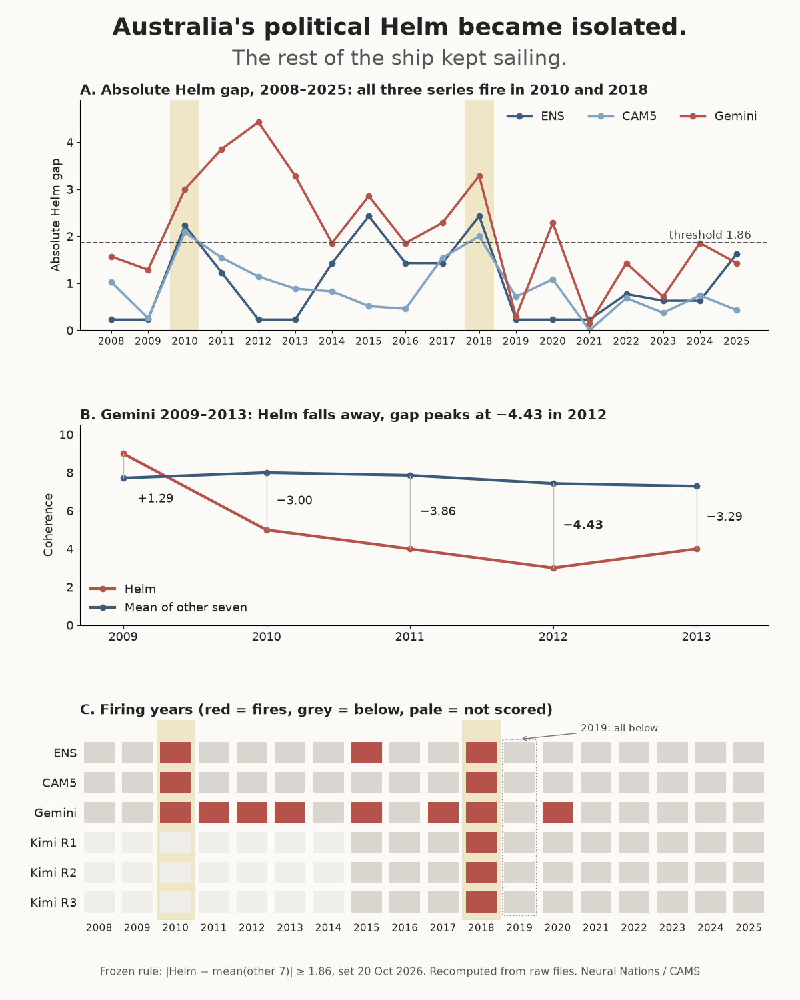
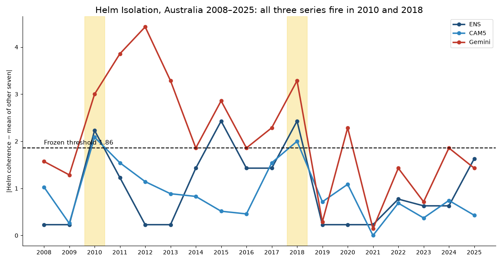
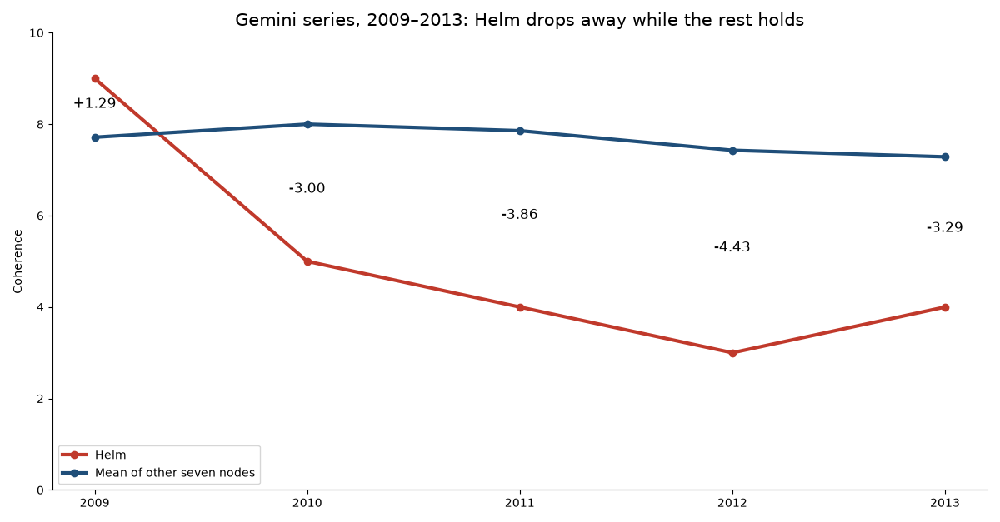
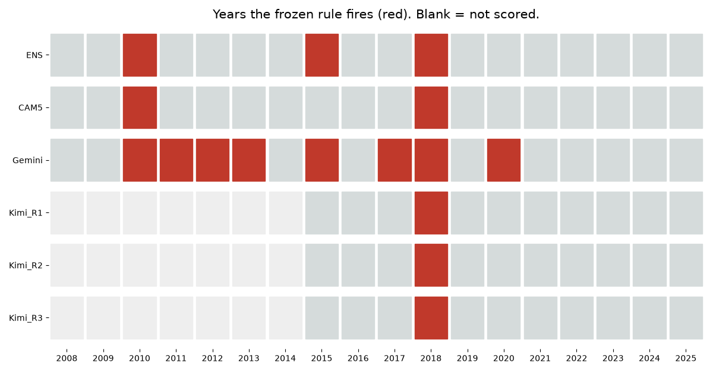

# Helm Isolation in Australia: cross-series agreement during the Rudd–Gillard years

**Neural Nations / CAMS: methods and results note**  
**Date:** 27 October 2026  
**Status:** Replication note and interim result; not a prospective validation  
**Scope:** Australia 2008–2025, with principal focus on 2010–2013 and the recurrence in 2018

## Abstract

We apply the *frozen* CAMS Helm Isolation signature, unchanged, to four Australian scoring series: the ENS long-run ensemble, the CAM5 multi-scorer ensemble, the January Gemini series (`Australian_Gem_Jan30.csv`) and three Kimi KSCORESv1 runs. All three historical series cross the 1.86-point absolute coherence-gap threshold in **2010 and 2018**, and all three are below it in **2019**. Gemini alone sustains a threshold-crossing interval through **2010–2013**, the period spanning the change from Kevin Rudd to Julia Gillard and Rudd's return. ENS and CAM5 corroborate the 2010 opening separation but do **not** show an uninterrupted four-year episode. The three Kimi runs, covering 2015–2025, fire in 2018 and in no other year, with signed gaps of −2.14, −2.14 and −3.14.

All scorers draw on a shared corpus: the globally accessible archive of Australian history. That archive is the instrument's material. The result reported here is that the same relational structure is recovered from it across different models, and across both single runs (Gemini, Kimi) and ensembles (ENS, CAM5). It is not proof of causality or of prediction. All values were recomputed from the raw files at pinned hashes.

## 1. Question and historical context

Did Helm, the steering and executive-coordination function, become unusually disconnected from the other functional systems of Australian society during the Rudd–Gillard years? Kevin Rudd was replaced by Julia Gillard in June 2010; she led a minority government after the 2010 federal election; Rudd returned to the prime ministership in June 2013. The comparison extends to the 2018 change of prime minister and the year after. These events supply *historical context*, not parameters inserted into the rule.

CAMS examines eight coordination roles together: **Helm** (direction), **Shield** (security and order), **Lore** (meaning), **Stewards** (assets), **Flow** (exchange and logistics), **Craft** (skills and production), **Hands** (labour) and **Archive** (institutional memory). Political history often foregrounds the executive and coercive institutions, economic history foregrounds production and exchange, and cultural history foregrounds meanings and memory. CAMS seeks a comparable account of the relationship among all eight.

This does not replace nuanced disciplinary explanation with a single index. It poses a measurable, cross-society and ultimately cross-scale question that can be evaluated against historical cases, control cases and out-of-sample data.

## 2. Pre-existing rule

The 20 October 2026 *Organisational Pathologies* report specifies:

D_t = C_Helm,t − (1/7) Σ_{j ≠ Helm} C_j,t,  I_t = |D_t|.

**Helm Isolation fires if and only if I_t ≥ 1.86**, using the **unrounded** computed gap. This is the published frozen pooled P95 threshold. The rule is *symmetric*: exceptional positive and negative separations both qualify. The published historical casebook calls **Australia 2010–2018** a Helm Isolation window; that is not a claim of nine consecutive annual firings.

Helm Isolation is distinct from **Helm Incompetence**, a three-year signature requiring falling Helm capacity, rising Helm stress, non-declining abstraction, and Craft and Flow capacity at or above their trailing mean. The published casebook assigned Australia 2010–2018 to Helm Isolation, not Helm Incompetence.

The rule, input files and outputs for this recompute were frozen in `PREREG.md` (27 October 2026) before any computation. No amendment was made.

## 3. Inputs and reproducibility

| Series | File | Coverage used | Rows | SHA-256 |
|---|---|---|---:|---|
| ENS (ensemble) | `cleaned_datasets/Australia_ENS_1875_2026_cleaned.csv` | 2008–2025 | 1,216 | `e121e06d…df646cc` |
| CAM5 (ensemble) | `cleaned_datasets/Australia_cam5_1996_2026_cleaned.csv` | 2008–2025 | 248 | `a72d4a9a…7dad1ef` |
| Gemini (single run) | `Australian_Gem_Jan30.csv` | 2008–2025 | 1,008 | `03893286…cb983` |
| Kimi R1–R3 (single runs) | `KSCORESv1_Australia_2015_2025_block0.csv` | 2015–2025 | 288 | `667889c7…62c` |

Full hashes:

- ENS: `e121e06da563154319eee36173174f472b259ed4b54f8eafe1870ae63df646cc`
- CAM5: `a72d4a9a0bb834f199a00ab1e85dbab8b216f4ddcf83df0f4ab34e7257dad1ef`
- Gemini: `0389328673575f3b78b9b46e03766a5bf4042c66ebb854881a3889d35a9cb983`
- Kimi: `667889c7127d3688eb44b6b08c96d4934446934c4ee1a4d5ea01730a244ac32c`

**Data-integrity note.** ENS, CAM5 and Gemini were recomputed from KaliBond/wintermute at commit `374bdf7` (`374bdf7e526fb23880bd88d67d067a384de658d9`). The earlier draft cited a Gemini file named `Australian_Gem_Jan30_CLEAN.csv` with 896 rows. No file of that name exists in the repository or the Kimi zip. The repository's `Australian_Gem_Jan30.csv` (1,008 data rows, 126 years; byte-identical copies at the root, `data/cleaned/` and `archive/Australia/`) was used instead, and it reproduces every Gemini value in the earlier draft. Kimi values come from `KSCORESv1_Australia_2015_2025_block0.csv` in `Kimi_Agent_Skill Build Requirements Discussion.zip` (runs R1–R3, model "Kimi K2.8 preview", run 27 October 2026). The Kimi file scores 2020 in two batches (B1, B2); both give the same gap (+0.571) in every run. Node names were already JUNO v1.2. The per-year signed gaps for every series are in `signed_gaps.csv`, produced by `run.py`.

## 4. Results: convergence and limits

### 4.1 Absolute gap by year

| Year | ENS | CAM5 | Gemini | Firing series |
|---|---:|---:|---:|---|
| 2009 | 0.23 | 0.26 | 1.29 | None |
| **2010** | **2.23** | **2.09** | **3.00** | **All three** |
| 2011 | 1.23 | 1.54 | **3.86** | Gemini only |
| 2012 | 0.23 | 1.14 | **4.43** | Gemini only |
| 2013 | 0.23 | 0.89 | **3.29** | Gemini only |
| 2014 | 1.43 | 0.83 | 1.86* | None |
| 2015 | **2.43** | 0.51 | **2.86** | ENS and Gemini |
| 2016 | 1.43 | 0.46 | 1.86* | None |
| 2017 | 1.43 | 1.54 | **2.29** | Gemini only |
| **2018** | **2.43** | **2.00** | **3.29** | **All three** |
| **2019** | 0.23 | 0.71 | 0.29 | **None** |
| 2020 | 0.23 | 1.09 | **2.29** (positive) | Gemini only |

Values are rounded for display only. \* Gemini 2014 and 2016 (and 2024) have gaps of exactly 13/7 ≈ 1.857, which **does not** meet the ≥ 1.86 threshold despite printing as 1.86.

All three historical series show **negative** signed Helm gaps in 2010 and 2018 (ENS −2.229 and −2.429; CAM5 −2.086 and −2.000; Gemini −3.000 and −3.286). The evidence is strongest for **event location** (2010 and 2018) and **gap sign**, weaker for **episode duration** (continuous 2010–2013 only in Gemini), and insufficient for inferring causal mechanisms.

### 4.2 Full firing list, 2008–2025

| Series | Firing years (signed gap) |
|---|---|
| ENS | 2010 (−2.229), 2015 (−2.429), 2018 (−2.429) |
| CAM5 | 2010 (−2.086), 2018 (−2.000) |
| Gemini | 2010 (−3.000), 2011 (−3.857), 2012 (−4.429), 2013 (−3.286), 2015 (−2.857), 2017 (−2.286), 2018 (−3.286), 2020 (+2.286) |
| Kimi R1 | 2018 (−2.143) |
| Kimi R2 | 2018 (−2.143) |
| Kimi R3 | 2018 (−3.143) |

Kimi covers 2015–2025 only. No series fires in 2019 or in 2021–2025.

### 4.3 Gemini during 2010–2013

In Gemini, Helm coherence falls from 9 in 2009 to 5 in 2010, 4 in 2011, 3 in 2012 and 4 in 2013. The mean of the other seven functions is about 8.00, 7.86, 7.43 and 7.29 over 2010–2013. The resulting signed gaps are −3.00, −3.86, −4.43 and −3.29, peaking in 2012. This is what *isolated Helm* means operationally: the coordination function's coherence sits sharply apart from the wider functional profile.

The score is **not** an assessment of the intelligence, ability or political worth of a prime minister. Nor does it imply that minority government could not legislate or that Australia's other functions stopped working. The model represents declining coherence in one function while the others retain substantial coherence and capacity.

### 4.4 Later reappearance and Kimi scoring

Gemini fires again in 2015 (−2.857) and 2017 (−2.286), and ENS fires in 2015 (−2.429), so the run-up to 2018 is not empty in every series. All three Kimi runs cross the frozen threshold in 2018, with signed gaps of −2.143, −2.143 and −3.143, and in no other year from 2015 to 2025. This extends the convergence to a further model, while the three runs remain repeated uses of one model family.

**Gemini also crosses the rule in 2020 with a positive signed gap** of +2.286. The symmetric frozen test counts this as Helm Isolation, but it is *not the same directional phenomenon* as 2010 and 2018, and any summary of post-2019 firings must keep that distinction. Gemini 2024 sits at 1.857, again just below the threshold.

## 5. Interpretation: relational configuration, not a government scorecard

The political chronology is well known. The added empirical proposition is that differently produced numerical readings, from several models and from both single runs and ensembles, place an exceptional separation between Helm coherence and the coherence of the remaining functions in 2010 and 2018. The method is not counting prime ministers or assigning a generic low score to the country. A society can keep its exchange systems, labour, accumulated expertise and public administration working while its executive coordination sits unusually far from the rest of the system.

This suggests a possible structural analogue of managerial decoupling: the steering function and the activities it is meant to align have different levels of internal compatibility. The analogy is a *research hypothesis*, not a demonstrated identity between households, companies and nations. Cross-scale work must test the same rule unchanged on non-national units and matched controls.

## 6. Constraints on the inference

**Shared corpus and consistency of extraction.** Every scorer reads the same globally accessible archive of Australian history. That shared corpus is the instrument's material, not a contaminant: CAMS is designed to extract functional structure from the record a society leaves. The open question is therefore not whether the sources are independent, but whether structure extraction is consistent: whether different models, single runs and ensembles recover the same configuration from the same record. On this case they agree on location and sign in 2010 and 2018 and diverge on duration, which is the measure of that consistency reported here.

**Hindsight and event anchoring.** Historical windows and familiar leaders were known before this analysis. The frozen threshold limits after-the-fact tuning but does not remove selection effects in which episodes get highlighted. Misses and false alarms must stay visible, including the Gemini firings in 2015, 2017 and 2020.

**Unequal sensitivity to duration.** ENS and CAM5 do not sustain the 2010–2013 firing seen in Gemini. The robust result is 2010 and 2018 as *cross-series* events, not cross-series confirmation of an uninterrupted Rudd–Gillard isolation.

**Threshold and rounding.** The 1.86 cutoff sits close to several observations: Gemini 2014, 2016 and 2024 at 1.857, and CAM5 2018 at 2.00. Firing is computed from unrounded values. A formal sensitivity analysis should report how many firings change under perturbations of ±0.1, ±0.25 and ±0.5 in individual node coherence scores, and under changes to the pooled reference population.

**Autocorrelation and chance.** The published pooled Helm Isolation historical-window result (17 observed against 8.41 expected; p = 0.004) is not an Australia-specific p-value. Null models must preserve temporal structure and score dependence before stronger probability statements can be made. The 696 firing society-years in the published report span six signatures, not Helm Isolation alone.

**Sign.** The rule's absolute value merges low-Helm and high-Helm outliers; each should be examined separately before claiming a common mechanism.

**Retrospective, not predictive.** This is a retrospective cross-series replication of a diagnostic rule, not a prospective forecast of leadership change or later outcomes.

## 7. Recommended next tests

1. Add further models and runs to the same Australian window under the unchanged rule, and report agreement on firing years, sign and duration as the consistency measure.
2. Add matched periods of stable and unstable executive coordination from other societies, selected independently of the rule's outcomes, including negative controls.
3. Test **negative** and **positive** Helm separation separately, keeping the symmetric rule as the preregistered primary analysis.
4. Estimate base-rate adjusted enrichment with temporal-block and autoregressive matched nulls; record missed windows as carefully as hits.
5. Run the threshold-perturbation sensitivity analysis described in section 6.
6. Re-run the unchanged rule on sub-national and organisational panels, recording all control firings before interpretation.

## 8. Conclusion

Under a rule frozen before this test, three separately produced historical series, two ensembles and one single-model run, all fire in **2010 and 2018** and all drop below the threshold in **2019**, with negative gaps in both firing years. Three further Kimi runs fire in 2018 and nowhere else in 2015–2025. Gemini gives the clearest sustained 2010–2013 separation, peaking at −4.43 in 2012, while ENS and CAM5 mark the opening rupture without matching its duration. Taken together, this shows the CAMS relational instrument recovering the same feature of Australian political coordination from a shared archive across models and scoring designs. The next step is to test that consistency on more models, controls and out-of-sample cases; it should not be promoted to causal or predictive validation until those tests succeed.

## Sources and files

- Neural Nations, [*Organisational Pathologies*](https://neuralnations.org/organisational-pathologies) (20 October 2026). Frozen signature preregistration commit `1b9b9f1`; results commit `58fcaaf`; source `juno/v3/JUNO_Unified_Dataset_v3_2026-10-19.csv` and `juno/v3/CAMS_Signature_Pack_v1.md`.
- [Australia ENS source CSV](https://github.com/KaliBond/wintermute/blob/374bdf7e526fb23880bd88d67d067a384de658d9/cleaned_datasets/Australia_ENS_1875_2026_cleaned.csv) at `374bdf7`.
- [Australia CAM5 source CSV](https://github.com/KaliBond/wintermute/blob/374bdf7e526fb23880bd88d67d067a384de658d9/cleaned_datasets/Australia_cam5_1996_2026_cleaned.csv) at `374bdf7`.
- [Australian_Gem_Jan30.csv](https://github.com/KaliBond/wintermute/blob/374bdf7e526fb23880bd88d67d067a384de658d9/Australian_Gem_Jan30.csv) at `374bdf7` (1,008 rows).
- `Kimi_Agent_Skill Build Requirements Discussion.zip`, containing `KSCORESv1_Australia_2015_2025_block0.csv` (288 rows).
- Derived: `PREREG.md`, `run.py`, `signed_gaps.csv`, `charts.py`, `dashboard.py`, `charts/`.
